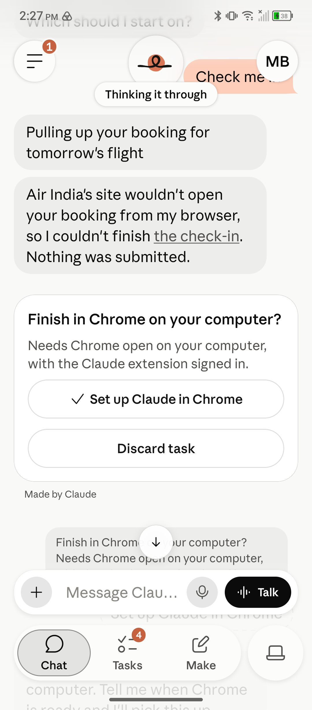

"India. 3 weeks. 4 cities. 3 hotels. 2 university guest houses. 1 trade show/conference/postproduction training workshop. 1 conference presentation. 1 panel presentation. 2 invited lectures. 2 caves. 1 temple. How? Claude: 1 bossy agent in my WhatsApp. 1 preview of Claude Duet."

One of my research projects interrogates film and media representations of devi, particularly the goddess Durga. I built my trip around not just the conferences, but experiential research for this and other projects. Three weeks, four cities, three talks, a panel and a workshop, plus the research, was more than I could hold in my head, so I handed the logistics to my Claude system before I left.

For example, my brief stay in Mysuru had been scheduled around two research needs: visiting a gallery to view and take notes on a painting of Durga there and to participate in darshan at Chamundeshwari, a temple dedicated to the goddess. Those were my needs anticipated before the trip, but since I had more time there I wanted some other site visit options and, most importantly, coffee shop options with wifi where I could work in my habitual style. I opened a separate Duet channel just for Mysuru and gave it the Leave Organizer's plan. "Isn't there a huge buddha statue by a lake?" It is, but in Hyderabad, in Hussain Sagar lake, so Duet added it to that leg instead. "I just arrived at the palace. How long do I have here before the art gallery?"

## The bossy agent

I set up the WhatsApp agent several weeks before the trip (and before my access to the preview of Duet) at first to share information that was already being shared with me in WhatsApp with my system. The conference at which I was presenting used a WhatsApp group to share information with participants: versions of the program as it developed, information on accommodations, asks, and social communication. I did not add an agent to this channel, but instead set up an isolated chat in WhatsApp that served as the only connection between the app and the project/agent Leave Organizer in my existing system. I then forwarded important information from the group to that channel, which passed it to my system. Before the trip, I also asked Leave Organizer to use the channel to send me scheduled reminders during the trip. If I had access to Duet before the trip, I could have set it up to do these things. Because the conference used WhatsApp, I likely would have still set up the agent chat there, but would probably have used Duet for the reminders. For most users, Duet is the right place for reminders, which is the work of a professional and personal assistant. It already produces morning briefs and manages tasks. While I am not using the morning briefs, I have worked with both Duet and my desktop system to integrate Duet's task system with my existing system's to-dos.

I chose to keep the agent out of the group chat. First and foremost, without consent by everyone in the group I would not have felt comfortable doing so. I believed that the perception of some folks in the group would be that they were being surveilled, but this may have been my own projection. There were technical reasons too, which my Leave Organizer found when it researched the setup in September: WhatsApp's official route can't join a group someone else created, and the unofficial tools that can read a group break WhatsApp's terms and put a ban on your own number. Forwarding to a separate chat sidestepped both. The forwarding design was my own idea; the research confirmed it.

I jokingly refer to the Leave Organizer WhatsApp agent as bossy, but it was only reacting to what the system has already learned about me. Some neurodivergence issues cause me to sometimes forget to eat, to burn out after being around groups of people, to leave for the day without having everything I need with me, to need multiple reminders of the same task, etc. Had the agent not been bossy, not only would important tasks have fallen through the cracks, but also some basic self-care needs. I include this because, if someone who is also neurodivergent reads this and sees how I use it, maybe it will inspire them, too.

Sometimes the bossiness was oddly precise. My first cave visit was Elephanta Island, at the very beginning of my trip (with reminders sent by Leave Organizer to apply mosquito repellent with, what I found to be kind of amusing, the particular kind of disease carried by the daytime mosquitos - Dengue. When I was out in nature in the evening, it told me to apply repellent because mosquitos potentially carrying malaria were out at night.) I was there to photograph and take notes on the Ardhanarishvara Carving.

## Duet, just in time

Once I had been granted preview access to Duet near the beginning of my trip, I used it for just-in-time needs. My system had already done extensive planning, and Duet allowed me to access those plans while on the go. But there were also things that were unplanned, and for those I turned to Duet.

## Check me in

On my first day with Duet I had a flight the next morning, so I typed "Check me in." After the Air India site would not allow Duet to check in for me, I turned to the Dispatch function on the Claude mobile app, which was able to launch the Air India website in my Claude-enabled Chrome browser on my always-on machine at home. Once the mobile app opened the browser on my home machine, Claude Duet took over that browser and completed the check-in. I was able to complete the check-in process there except for entering my passport information and other personal information. That is an important guardrail. Had I been able to do so from the Claude mobile app, I would not only have shared sensitive information with Claude, but would also have been passing sensitive personal information over a public coffee shop network from my phone to the cloud and then to my home machine.

That night there was no hotel email anywhere in my mail, so Duet wrote me a script to read at the front desk for a 4:05 am airport car. When I signed off, it said: "Good night. When you get back, remember to ask the front desk for the 4:05am car."

## Small things, all the time

Most of what it did was small and constant: flight times, which meeting was when, what a shop was, a Toronto editor's deadline converted to Indian time, and a review reminder kept beside my own WhatsApp one. "I don't want the WhatsApp reminder cancelled; I just need both."

## What it got wrong on the road

Once, a card answering "What time is my upcoming flight to Hyderabad?" showed my booking code. When I posted about the trip, I scrambled the e-ticket code out of the screenshot by hand. Why I should have set firm rules about private details from the start is in [my post on testing Duet](/blog/posts/testing-claude-duet/).

## Where I land

Duet turned out to be a helpful companion on the road, providing me with just-in-time assistance while having access to context and processes on my desktop Claude system back home.
