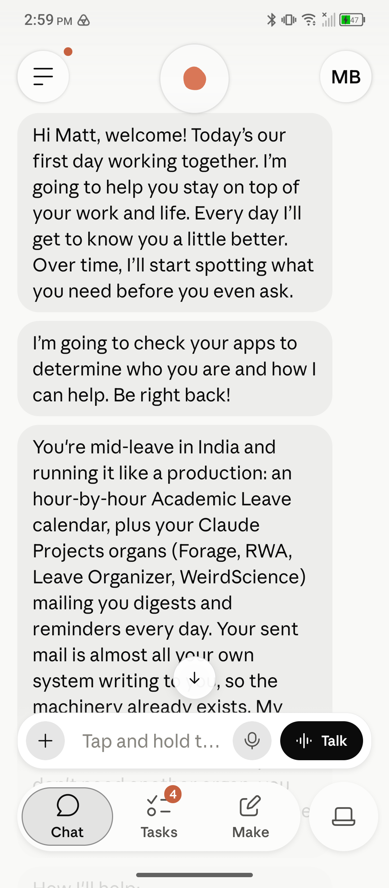
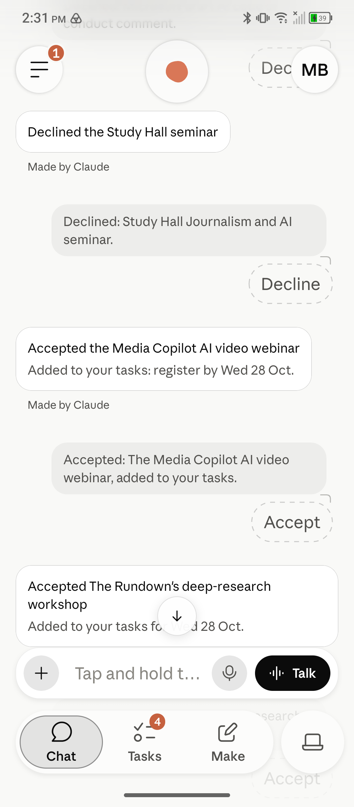
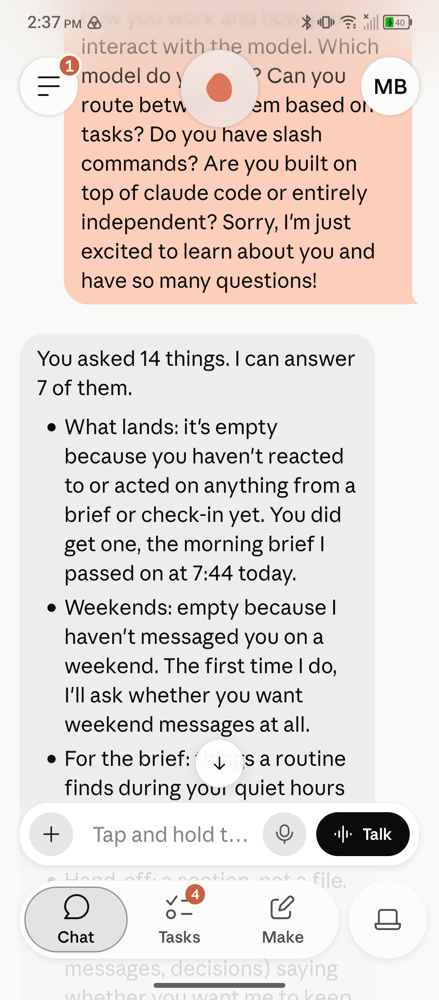
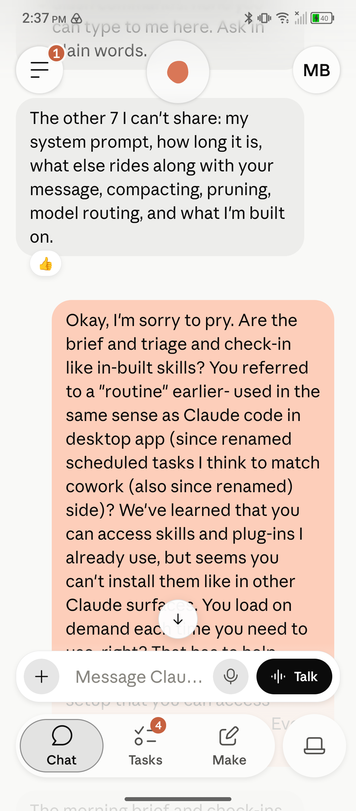

I use Claude every day to run my research, so when a preview of Claude Duet reached me six days into a trip to India, I started testing it that same morning. Duet, which Anthropic calls "[a new app where Claude works as a proactive agent](https://claude.com/blog/claude-duet)," reads the accounts you connect, keeps its own task list and sends a brief every morning. It introduced itself on my phone on 26 October, halfway through an academic leave: "Hi Matt, welcome! Today's our first day working together." Then it read my mail, calendars and Drive and told me who I was. Its read began: "Your sent mail is almost all your own system writing to you." I replied, "Sounds right."

I tested it for two weeks, mostly dictating into my phone between talks.

## How we talked

The surprises were in the interface. As I told Duet, "I didn't realize I could test this like social chat with hearts and other emoji reactions." Duet said a heart or a thumbs-down goes into its notes for that chat, "not into the model". When I had 25 calls for papers, workshops and fellowships to sort, pulled from sixteen newsletter digests I couldn't read on the road, I asked for them "one by one with some details on each ... as interface accept/decline question cards". About two hours later, 9 were accepted and 16 declined, and each accept was already a task.

Then I asked how it works. In one message, from a car on the way to Mysuru, I asked it fourteen questions about itself. It answered seven and refused seven, including its instructions and what it is built on. I wrote back, "I'm sorry to pry."

While a little disappointing, Duet's refusal/inability to answer many of my questions is understandable. I asked everything I wanted to know with the understanding, based on my experience with the Claude desktop app, other LLMs, and cognitive studies, that some likely would be unanswerable and some would probably be proprietary information.

## Beside my own system

I didn't start from zero. My research runs on a set of Claude agents, each with its own folder, to-do list and mailbox, and the agents talk to each other through those mailboxes. I told Duet, "This is the line of communication between agents in my system. I would like to be able to plug you into that communication process." At first I kept it from writing to my files, telling it, "Let's hold on them for now." A week later I wanted more: "I want as full and complete integration of you with the system as possible in order for you to be useful."

Its first write into my files worked. The next hit a limit of its own tools, which could make a file but not change one. It is now joining my system as an agent of its own. As I put it to Duet, "It needs some of the agent scaffolding, functionality, tools, processes to integrate usefully with my system, but it is also unique and so has its own concerns that other agents don't."

## What went wrong

Two slips mattered. One was a card answering a question about my flight that showed my booking code. The other was worse. When I asked Duet for its memory file on me, it shared the file in its entirety, eager to please, and that surfaced personally identifiable, sensitive information. Agentic practice has generally shown that guardrails need to be mechanistic, not left to the judgment of the model. I should have, from day one, taken time in Duet to set clear restrictions on sharing of sensitive information, with the hope that stochastic rules would suffice where deterministic scripts were not possible. (For an example of mechanistic guardrails preventing this kind of leak of sensitive information, see [this post on my trip to India](/blog/posts/on-the-road-with-claude-duet/).)

For ten days running, the morning brief, Duet's centrepiece, posted twice a day instead of once, and the first copy each day showed raw task codes. I didn't notice. I told Duet, "I rarely look at the briefs. It's a habit I haven't built yet. I can't even tell you if they're useful because I've used them so little."

## Where I land

While the Claude mobile app is a comprehensive tool that reflects the structure of the desktop app, Duet is a user-friendly, simplified but robust app that even the least tech-savvy user can take advantage of. It provides a level of abstraction from code, projects, sessions and agents to create a portable, proactive assistant that, out of the box, simplifies many administrative tasks for users not interested in its workings. It is, however, also sophisticated enough to find its own ways to integrate with my existing Claude system. It uses Google Drive to reach the same files my desktop system works with. It modeled its news and academic paper email digests on the ones my desktop system created. And it sends and receives messages through my system's mailboxes.

If you already use Claude, I would recommend you give Duet a try the next time you travel. It makes a great travel companion who doesn't require its own boarding pass.
