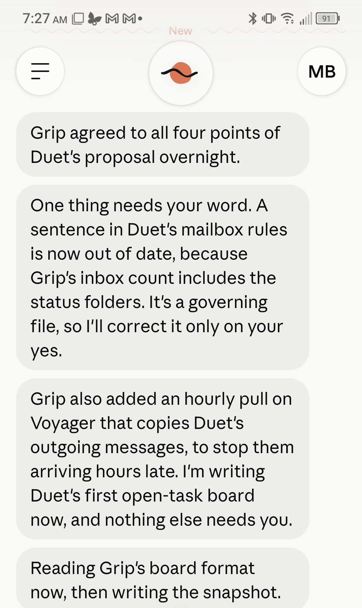

I use Claude every day to run my research, so when a preview of Claude Duet reached me in the middle of a trip to India, I started testing it that same morning. Claude Duet introduced itself on my phone on 26 October, in India, halfway through an academic leave: "Hi Matt, welcome! Today's our first day working together." Then it read my mail, calendars and Drive and told me who I was. Its read began: "Your sent mail is almost all your own system writing to you." "Sounds right."

Duet is a preview: a Claude that lives in the phone and desktop apps, reads the accounts you connect, keeps its own task list and sends a brief every morning. I tested it for two weeks, mostly dictating into my phone between talks.

## How we talked

The surprises were in the interface. "I didn't realize I could test this like social chat with hearts and other emoji reactions." Duet said a heart or a thumbs-down goes into its notes for that chat, "not into the model". When I had 25 calls for papers, workshops and fellowships to sort, pulled from sixteen newsletter digests I couldn't read on the road, I asked for them "one by one with some details on each ... as interface accept/decline question cards". About two hours later, 9 were accepted and 16 declined, and each accept was already a task.

Then I asked how it works. In one message, from a car on the way to Mysuru, I asked it fourteen questions about itself. It answered seven and refused seven, including its instructions and what it is built on. "Okay, I'm sorry to pry."

While a little disappointing, Duet's refusal/inability to answer many of my questions is understandable. I asked everything I wanted to know with the understanding, based on my experience with the Claude desktop app and other harnesses, LLMs, and cognitive studies, that some likely would be unanswerable and some would probably be proprietary information. For example, I became interested in Claude's system prompts as I started to learn about context engineering and wanted to know if 1) anything could be trimmed from it to reduce context without sacrificing performance in a 3P installation and 2) if I could model the system prompt for other harnesses based on it to get some of its spectacular performance. While it has allegedly been leaked and posted to GitHub, I learned from Claude itself that the system prompt used by Claude Code is hard-coded in the desktop app, but that API calls to Claude can use customized system prompts. According to Anthropic's Thariq Shihipar, [newer Claude models require less system prompt](https://the-decoder.com/anthropic-says-it-cut-80-percent-of-claude-codes-system-prompt-because-fable-5-models-want-a-smaller-system-prompt/) than previous versions.

## Beside my own system

I didn't start from zero. My research runs on a set of Claude projects I call organs, each with its own folder, to-do list and mailbox. "This is the line of communication between 'agents' in my system, sort of based on old Blackboard systems. I would like to be able to plug you into that communication process." At first I kept it from writing to my files: "Let's hold on them for now." A week later I wanted more: "I want as full and complete integration of you with the system as possible in order for you to be useful."

Its first write into my files worked. The next hit a limit of its own tools, which could make a file but not change one. It is now joining my system as an organ of its own. "It needs some of the organ scaffolding, functionality, tools, processes to integrate usefully with my system, but it is also unique and so has its own concerns that other organs don't."

## What went wrong

Two slips mattered. One was a card answering a question about my flight that showed my booking code. The other was worse: agentic practice has generally shown that guardrails need to be mechanistic, not left to the judgment of the model. I should have, from day one, taken time in Duet to set clear restrictions on sharing of sensitive information, with the hope that stochastic rules would suffice where deterministic scripts were not possible. Because I did not do this immediately after receiving access, Duet, eager to please, shared its memory file on me in its entirety when I asked for it to do so, which did surface personally identifiable, sensitive information. (For an example of mechanistic guardrails preventing this kind of leak of sensitive information, see [this post on my trip to India](/blog/posts/on-the-road-with-claude-duet/).)

The morning brief, Duet's centrepiece, posted twice a day for ten days running, the first copy with raw task codes showing. I didn't notice. "I rarely look at the briefs. It's a habit I haven't built yet. I can't even tell you if they're useful because I've used them so little."

## Where I land

While the Claude mobile app is a comprehensive tool that reflects the structure of the desktop app, Duet is a user-friendly, simplified but robust app that even the least tech-savvy user can take advantage of. It provides a level of abstraction from code, projects, sessions, agents to create a portable, proactive assistant that, out of the box, simplifies many administrative tasks for users not interested in its workings. It is, however, also sophisticated enough to find ways itself to integrate with my existing Claude system: using Drive to reach files for my desktop system, modeling news and academic paper email digests on how my desktop system created them initially, and sending and receiving communication with the system by tapping into its Blackboard-like mailbox system.
