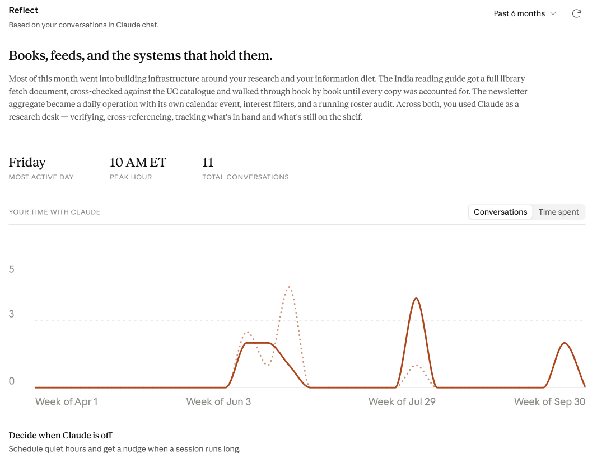
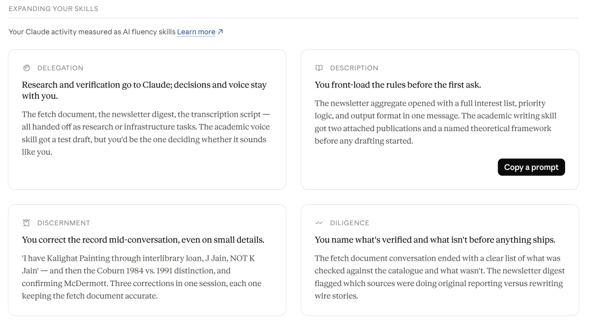
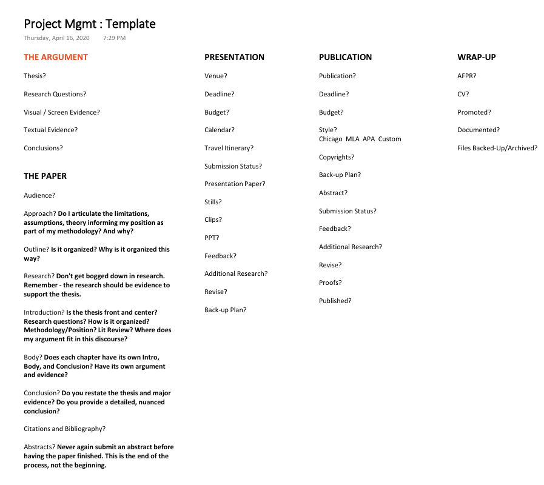
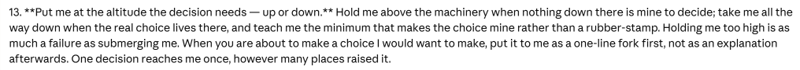
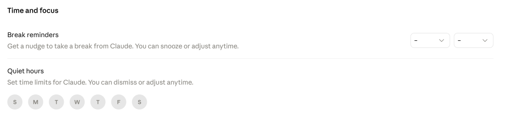
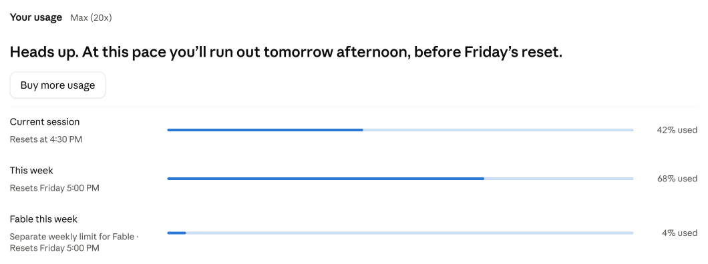

* Claude's new Reflect feature sees me and my research, partially.
* Why you should begin at D for Delegation, initially.
* How files keep Claude coherent, usually.

When I first noticed the new menu item in the Claude desktop settings, I clicked on Reflect expecting the results to be some algorithmic greatest hits of Claude usage, like the year-end Spotify Wrapped hoopla. "You expressed frustration with Claude 17 times this month. Let's celebrate!"

Reflect is a new beta feature in Claude's settings. It summarizes how you have used Claude chat over the past one to twelve months: your topics, your busiest days and hours, and examples of how you work with it. ([Anthropic, 9 July 2026](https://www.anthropic.com/news/reflect-with-claude))

The results shocked me a little: "I spend a lot of time in research." All of the reflections were dominated by my use of Claude to do things like find call numbers, make fetch lists to get physical books from the library, verify sources I need versus those I hold. I also had a little chuckle because many of the Discernment notes mentioned my correcting of Claude mid-conversation. "Do I cut *people* off and correct them mid-conversation?"

## What Reflect can't see

Reflect read only 11 conversations over six months because it reads only Claude chat. In July, Anthropic said reflections on Cowork, the workspace where projects, files and tools live, were "available soon"; in September, Cowork and chat merged into one Claude ([Claude, 16 September 2026](https://claude.com/resources/articles/cowork-is-now-claude)). I spent a thousand-plus hours building a multiagent system that creates 8-bit video games, generates video clips on my home machines, and tells me what episodes of podcasts to listen to. And all Reflect could tell me was I spend a lot of time with my nose (and my brain) in books?

What about the Executive Function project I meticulously crafted as the surface through which I intended to work in Claude? At the system's peak size, it was designed to be the orchestrator of ~30 interconnected projects or "organs" as I refer to them. It's named Executive Function because I am neurodivergent and have some executive function issues, so I envisioned it as a tool to keep my thinking linear and keep my focus in one place. What has happened though, is that I use Claude how I think, jumping from project to project, working directly in one and then moving to another. I spend less time in Executive Function than most of the other projects, probably because it is all business: sign off on this grant, this is overdue, this project needs a stance file replaced. The projects are where the fun is — they are work, but it's fun work.

Reflect told me truths about myself, but only partial truths. Well-organized partial truths.

## The four Ds

Reflect structures its comments using Anthropic's 4D AI Fluency Framework ([Rick Dakan, Joseph Feller and Anthropic](https://www-cdn.anthropic.com/334975cdec18f744b4fa511dc8518bd8d119d29d.pdf)):
- **Delegation:** "Setting goals and deciding whether, when and how to engage with AI"
- **Description:** "Effectively describing goals to prompt useful AI behaviors and outputs"
- **Discernment:** "Accurately assessing the usefulness of AI outputs and behaviors"
- **Diligence:** "Taking responsibility for what we do with AI and how we do it"

All four D's were accurate in themselves, but somehow felt like they missed the bigger picture. Description was probably the most resonant with me. I'm a very systems-oriented person and I read this comment about me as accurately gauging my inclination to plan, organize, and enact a system. (My ability to keep within that system, however, is another story entirely.) 

For colleagues who are just starting out on an exploration of how they might use AI in their work, I suggest starting with Delegation. I've heard from many different fronts that human judgment is the one foundational thing you should not offload to AI, and it's a gate I have adopted in making decisions about what to delegate to Claude. I am, however, interested in autonomous AI, and so I will sometimes experiment with pushing that limit. In fact, right now I am engaged in a project that will probably sound reprehensible to my fellow teachers, especially those who forbid any form of AI involvement in their students' academic writing. What if it was any form of *human* involvement that was forbidden in academic writing?

## What I don't use it for

I don't use any Claude desktop app, CLI, or web access at all on my university-owned work laptop — it is expressly forbidden for university work ([UC News](https://www.uc.edu/news/articles/2026/07/claude-now-available-in-bearcatsgpt-ai-platform.html)). Digital Technology Solutions announced, however, that Claude has been added to our approved, closed and secure BearcatGPT system as a model option. I have no idea which Claude models are available because I haven't used BearcatGPT regularly since beta testing. I have looked at it recently though, and the interface is still just a chatbot. There are "agents," but these seem to be the chatbot with searchable access to specialized documents. 

The real power and benefit of Claude, I believe, is the combination of the models and the harness of the desktop app. If we are only given access to more chatbots, I am afraid that our faculty, staff, and students are going to remain stuck in the dark ages of prompt engineering instead of learning the current necessary skills of context engineering, memory management, and true agentic AI. However, I understand the risks involved when personally identifiable student information could be disclosed, violating federal law (FERPA). So, no live or past class information, private or proprietary data. 

So what do I use it for? To manage my personal research, creative work, and experimentation.

## "A sea of sameness"

*Project Mgmt : Template, OneNote, April 2020*

For a long time, I used typed notes in OneNote to manage research projects, and not well. For me, too much visibility of my workload is the same as invisibility. In OneNote, I kept every project, no matter how large or small or stage of development or priority, in front of me. When I am presented with an overwhelming amount of information it is very easy for the important items to get lost among those of less importance. There was a sea of sameness that my mind just could not effectively sort through. Claude helps me manage this by just talking with it about what is on my plate, what has upcoming deadlines, what tasks are holding up other tasks. 

One thing I set up very early on in how Claude talks to me and works with my system is what I refer to as "altitude," and because I gave it explicit instructions to do so, it allows me to change my altitude in a project. If I am at too low an altitude, getting too much detail, being asked too many granular questions and I become overwhelmed, I just ask it to change my altitude to a higher level. Then it talks to me about bigger picture items, a level higher of abstraction from the technical architectural and substrate details to conversation with which I am more comfortable in the moment.

*Put me at the altitude the decision needs — up or down. Hold me above the machinery when nothing down there is mine to decide; take me all the way down when the real choice lives there, and teach me the minimum that makes the choice mine rather than a rubber-stamp. Holding me too high is as much a failure as submerging me. When you are about to make a choice I would want to make, put it to me as a one-line fork first, not as an explanation afterwards. One decision reaches me once, however many places raised it.*

This quote from my Instructions for Claude, global instructions set in the desktop app interface and applied to every project, also gets back to the D of Delegation: "teach me the minimum that makes the choice mine rather than a rubber-stamp." I want to make informed decisions about the system, especially when I don't fully understand them, rather than delegating them to the system itself. So I ask Claude to teach me what I don't know. 

## "Only Matt circles a take"

In addition to defining what Claude can and can't / should and shouldn't do, it's important to define what my own responsibilities are for each project. Here is an example from the CLAUDE.md file in my FilmStudio project, a toolchain and workflow for media generation using local, open-source models:

This is generally referred to as a stance file: it defines the project (what it does, instructions, methods, responsibilities, constraints, etc.) but is also a place where I can make my expectations for Delegation explicit. Different kinds of projects require different expectations for Delegation, which is really about ownership of my work. For example, the stance files for my writing projects require that all writing be in my own words. Above, some of how I own my video production work is illustrated. I use Claude for creative work. I use it for film studies research. And, increasingly, I use Claude to research Claude.

## "SO. MUCH. FUN."

Most of my research applies psychoanalytic theory to cultural products, but it is rooted in a deep interest in how minds work. Cognitive studies informed by neuroscience, the basis of much work in artificial intelligence, are often seen as a foil to psychoanalysis. I initially became interested in AI as a way to experiment with psychoanalytic ideas, like the Freudian model of mind, Lacanian desire, and Julia Kristeva's theory of abjection, using artificial minds. I am still engaged in that experimentation, but that initial engagement caused my AI interests to catch like wildfire. I have more questions than I have answers for right now, but they are questions for which the search for answers is just SO. MUCH. FUN. One such question that has consumed me and led me to learn about harness engineering, context, memory stores, prompt caching, and much more is:

*How can a stateless system, with no inherent persistence, reconstitute itself every turn and every session so that the user perceives a seamless conversation?*

## Back to Reflecting on Reflect

Since first working in Claude Cowork and seeing how it differed from a chatbot, that question has been the central research question driving a project I have named "Files as Cognition." Stance files, memory files, state files, registers, documentation, handoff files — all of this works together to create not just a seamless conversation but (when it's working well) the illusion of a seamless artificial mind.

Sometimes the seams unravel and show, when divisions of that mind aren't accessible to other divisions, when communication fails, when files are lost. Or, when Reflect bases its knowledge of you on the 11 conversations it has access to and not the hundreds of others you have held with it over the course of a thousand-plus hyperfixated hours.

Reflect has a companion page in the same settings, Time and focus, where you can set break reminders and quiet hours.

Now if I could only force myself to use *that* Claude feature...

... I might stop eating up my token rations three days into a new week.

*Written in collaboration with Claude Opus 5.5.*
